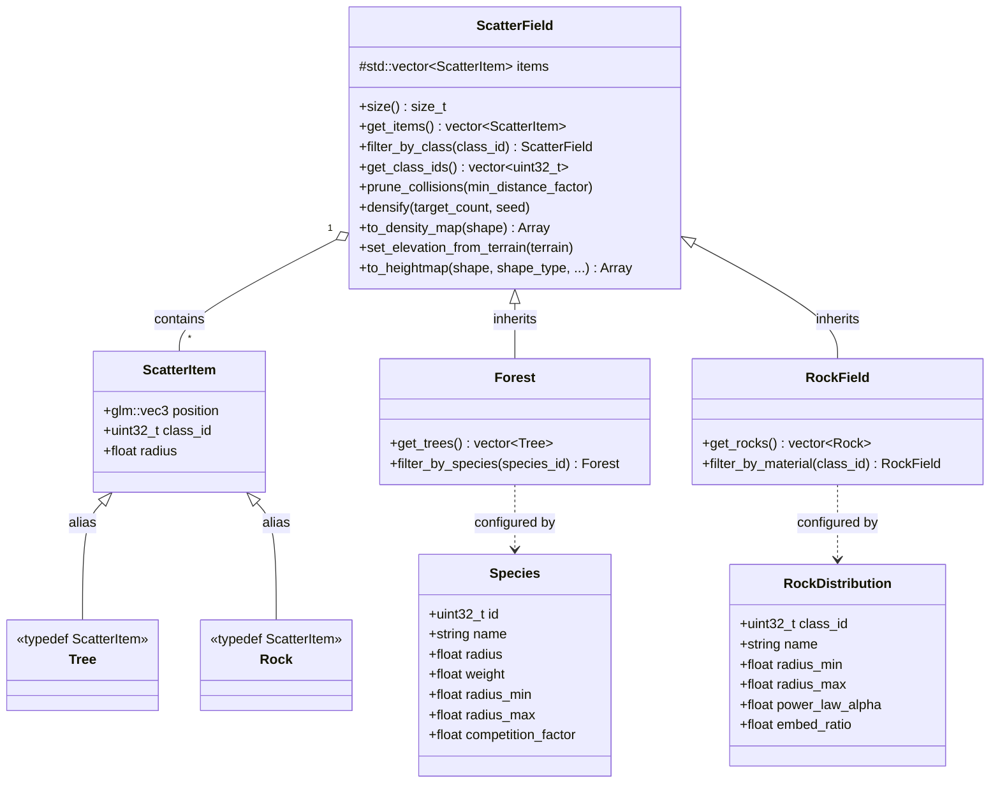

# Scatter Architecture: ScatterField, Forest, and RockField

This document details the uniform scattering architecture in HighMap, describing the relationship between the base `ScatterField` container and its domain-specific specializations: `Forest` and `RockField`.

## 1. Class and Dependency Diagram

The architecture decouples lightweight instance storage from domain descriptors and simulation algorithms.

## 2. Design Principles

### Uniform Instance Representation
All discrete spatial entities inherit a minimal three-attribute representation:
- `position` (`glm::vec3`): 3D spatial coordinate ($x, y$ ground position and elevation $z$).
- `class_id` (`uint32_t`): Integer category identifier mapping to a biological species, rock material, or mesh asset.
- `radius` (`float`): Characteristic collision or influence radius.

`Tree` and `Rock` are type aliases of `ScatterItem` (`using Tree = ScatterItem;`, `using Rock = ScatterItem;`).

### Inheritance and Reuse
`ScatterField` provides generic spatial queries and transforms common to any scattered entity:
- **Spatial queries**: Bounding box evaluation, point queries, class-based filtering (`filter_by_class`).
- **Spatial organization**: Delaunay triangulation densification (`densify`), spatial collision pruning (`prune_collisions`).
- **Raster integration**: Elevation snapping (`set_elevation_from_terrain`), rasterization into density maps (`to_density_map`), and stamp-based heightmap rasterization (`to_heightmap`).

Both `Forest` and `RockField` publicly inherit from `ScatterField`. They inherit the full suite of spatial operations without duplicating spatial indexing or container logic.

### Descriptor Separation
Instance containers store only per-instance spatial state (`position`, `class_id`, `radius`). Metadata and physical parameters are separated into lightweight descriptor structures:
- `Species`: Biological traits (growth limits, relative seeding weight, shade/canopy competition factors).
- `RockDistribution`: Geomorphological parameters (Pareto power-law exponent $\alpha$, minimum/maximum radius, embed ratio).

Simulation algorithms take instance fields alongside descriptor arrays. This keeps memory footprint minimal when storing millions of scattered entities.

## 3. Subsystem Connections

### Flora Subsystem (`Forest`)
`Forest` models vegetation and tree distributions.
- **Seeding**: `seed_forest_density` and `seed_forest_species` populate `Forest` instances using environmental suitability rasters (slope, elevation, moisture) and species weights.
- **Simulation**: Biological competition is simulated via `grow_forest_competition` and `simulate_forest_cycle`, which iterate through the `Tree` instances and adjust radii or eliminate suppressed individuals based on canopy overlap.

### Rocks Subsystem (`RockField`)
`RockField` models talus slopes, scree fields, and boulder deposits.
- **Seeding**: `seed_rocks_talus` and `seed_rocks_distribution` generate rocks following Pareto power-law distributions, where small rocks outnumber large boulders according to `power_law_alpha`.
- **Simulation**: Geomorphological sorting via `simulate_rock_sorting` sorts items downslope according to gravitational energy and substrate friction, adjusting spatial distribution based on terrain gradient.

## 4. Converting to Raster Fields

A `ScatterField` (and by extension `Forest` or `RockField`) can be rasterized back into the elevation domain:
- `to_density_map`: Generates a continuous `Array` indicating entity density per cell.
- `to_heightmap`: Splats discrete geometric profiles (disks, cones, pyramids, smooth domes) onto an existing `Array` using maximum or additive blending.
