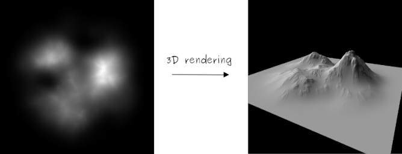

# HighMap Documentation

HighMap is a C++ library for procedural generation, simulation, and analysis of 2D heightmaps and terrain assets.

A heightmap is a two-dimensional grid of elevation values. Each cell corresponds to a spatial position, with values typically normalized to $[0, 1]$ or expressed in world elevation units.

## Documentation

### Getting Started

Documentation for new users:

- [Quickstart](content/getting_started/quickstart.md): Minimal working example, CMake integration, and common operations.
- [Core Concepts](content/getting_started/core_concepts.md): Elevation data structures (`Array`, `HeightMap`, `VirtualArray`), bivariate functions, vector primitives, and entity scattering.

### Developer Documentation

Documentation on codebase architecture and design:

- [Architecture Overview](content/dev/architecture.md): Module hierarchy, layered subsystem design, and architectural principles.

## Installation

For build prerequisites and installation instructions, refer to the repository README:
[https://github.com/otto-link/HighMap](https://github.com/otto-link/HighMap)
